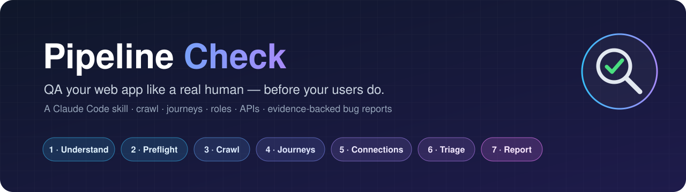
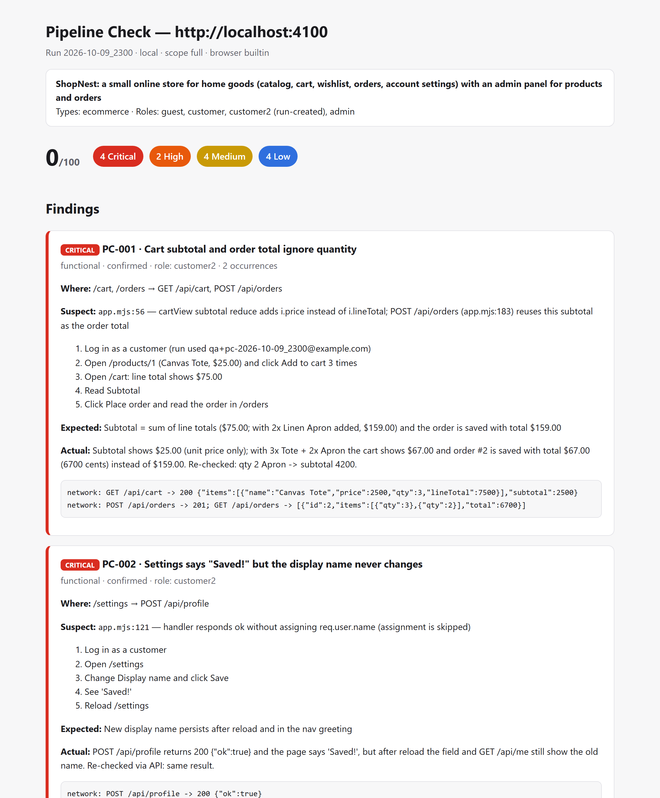
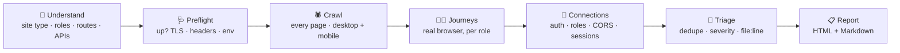

<p align="center">
  
</p>

<p align="center">
  <a href="https://claude.com/claude-code"></a>
  
  
  
  <a href="LICENSE"></a>
</p>

<p align="center">
  <b>Your app says "Saved!" — but is it?</b><br>
  <code>pipeline-check</code> makes Claude test your website the way a picky human QA engineer would:<br>
  it learns what your product <i>is</i>, then clicks, types, buys, logs out, tries the admin panel as a customer…<br>
  and hands you a prioritized bug report pointing at the exact file in your code.
</p>

<p align="center">
  <a href="#-install">Install</a> ·
  <a href="#-usage">Usage</a> ·
  <a href="#-what-it-catches">What it catches</a> ·
  <a href="#%EF%B8%8F-safety-first">Safety</a> ·
  <a href="#-try-it-on-the-demo-shop">Demo</a>
</p>

---

## ✨ Why

Unit tests check functions. E2E suites check the flows you remembered to write. **Nobody checks the flows you forgot.**

`pipeline-check` doesn't need a test suite. It reads your code to understand the product, then explores it like a real user, in every role, with a script-powered crawler making sure no page is skipped.

> 🛒 On an online store it adds the same product twice and checks the cart total.
> 🔐 On anything with an admin panel it logs in as a *customer* and tries the admin APIs.
> 💾 Everywhere, after every "Saved!", it reloads the page to see if it really saved.

## 📸 What you get

<p align="center">
  
</p>

Every finding comes with **severity**, **role**, **repro steps**, **expected vs actual**, **console/network evidence** and the **suspected `file:line`**, as `report.html` + `report.md`.

## 🔄 How it works



| Phase | Who does it | What happens |
|---|---|---|
| 🧠 **Understand** | Claude | Reads your models, routes and copy → *"This is an online store with a blog and an admin panel."* You confirm. |
| 🩺 **Preflight** | script | Reachability, redirects, TLS expiry, security headers, missing env vars |
| 🕷️ **Crawl** | script | Every page × desktop/mobile: console errors, failed requests, broken links/images, axe a11y, load time, layout shift, secrets in JS |
| 🧑‍💻 **Journeys** | Claude + browser | Site-type playbooks as guest → customer → admin, with a persistence check after every write |
| 🔌 **Connections** | script + Claude | APIs without auth, role bypass, CORS, logout that doesn't log out, IDOR, webhooks |
| 🧮 **Triage** | Claude | Dedupe by root cause, grade severity, re-check every critical/high, trace to the line |
| 📋 **Report** | script | Health score, findings, coverage, leftovers |

## 🎯 It adapts to your site

| | Site type | Things it will absolutely try |
|---|---|---|
| 🛒 | **E-commerce** | Same item twice, qty 0/-1/999, totals math, coupons, wishlist after logout, out-of-stock, checkout (test mode) |
| 📊 | **SaaS** | Onboarding dead-ends, workspace data leaks, member vs owner powers, plan limits, invites |
| 🏪 | **Marketplace** | Editing someone else's listing, private messages, sold items still buyable |
| 📅 | **Booking** | Double-booking the same slot, timezones, cancel frees the slot |
| 📰 | **Content / blog** | Drafts reachable publicly, comment XSS, feeds, SEO basics |
| 💬 | **Social** | Private posts visible, blocking that doesn't block, counts drifting |
| 🎓 | **Courses (LMS)** | Paid lessons without enrollment, quiz answers in the API, progress resets |
| 🚀 | **Landing page** | CTAs to nowhere, lead forms that say "thanks" while the request failed |

Has an **admin panel**? It asks for admin access, tests every admin feature, and checks that admin changes show up on the customer side (new price → storefront → cart).

## 🐛 What it catches

<table>
<tr><td>

**🔴 Critical**
- Money math wrong (totals, discounts, tax)
- "Saved!" but nothing saved
- APIs that answer without login
- Customers reaching admin data
- Secrets shipped in your JS bundle

</td><td>

**🟠 High**
- Forms that 500
- Logout that doesn't end the session
- Broken integrations
- Admin edits not reaching the shop

</td><td>

**🟡 Medium · 🔵 Low**
- Broken links & images
- Uncaught JS errors
- Missing loading / empty / error states
- Slow pages, layout shift, broken mobile layout
- Accessibility & security-header gaps

</td></tr>
</table>

## 📦 Install

**Requirements:** [Claude Code](https://claude.com/claude-code), [Node.js](https://nodejs.org) ≥ 21, Git.

```bash
git clone https://github.com/AhmadowMP3/Pipeline-checker-skill.git ~/.claude/skills/pipeline-check
cd ~/.claude/skills/pipeline-check/scripts
npm install
npx playwright install chromium
```

<details>
<summary>🪟 Windows (PowerShell)</summary>

```powershell
git clone https://github.com/AhmadowMP3/Pipeline-checker-skill.git "$HOME\.claude\skills\pipeline-check"
cd "$HOME\.claude\skills\pipeline-check\scripts"
npm install
npx playwright install chromium
```
</details>

Restart Claude Code. `pipeline-check` now shows up in your skills. 🎉

## 🚀 Usage

Open your web project in Claude Code and run:

```
/pipeline-check http://localhost:3000
```

…or just say *"QA my site"*, *"test my app like a user"*, *"find bugs before launch"*.

| Option | What it does |
|---|---|
| `--scope full` *(default)* | All 7 phases |
| `--scope quick` | Crawl + login + the single most important journey per site type |
| `--focus J1,J4` | Run only these journeys |
| `--browser builtin` | Claude's built-in browser *(default for localhost)* |
| `--browser chrome` | Your real Chrome via Claude in Chrome *(default for deployed sites: fewer bot blocks, uses your existing login)* |

Results land in `<your-project>/.pipeline-check/runs/<timestamp>/`. The skill offers to add `.pipeline-check/` to your `.gitignore`.

<details>
<summary>🔑 Testing logged-in & admin areas (local)</summary>

Put **test** credentials in `<your-project>/.pipeline-check/config.json`, or let the skill find your seed accounts and propose them:

```json
{
  "roles": {
    "customer": { "url": "/login", "fields": { "#email": "customer@shop.test", "#password": "local-test-pw" }, "submit": "button[type=submit]" },
    "admin":    { "url": "/login", "fields": { "#email": "admin@shop.test",    "#password": "local-admin-pw" }, "submit": "button[type=submit]" }
  },
  "exclude": ["/admin/danger-zone"],
  "limits": { "maxPages": 150, "maxMinutes": 20 }
}
```

On **deployed** sites, you sign in yourself in your browser. The skill never asks for production passwords.
</details>

## 🛡️ Safety first

Built to be pointed at *your own* apps, **including production**.

| | localhost | deployed |
|---|:---:|:---:|
| Browse & crawl | ✅ | ✅ (gentler) |
| Type test credentials | ✅ | ❌ you sign in yourself |
| Create / edit / delete data | ✅ only its own test data | ⚠️ only after you approve a list, only its own `[PC-…]` records, then cleans up |
| API write probes | ✅ | ⚠️ never guesses ids, never creates data |
| Side-effect endpoints (`cron`, `seed`, `reset`, `send`, `webhook`…) | ⛔ skipped | ⛔ skipped |
| Logout / delete / refund / approve links while crawling | ⛔ never followed | ⛔ never followed |
| CAPTCHA, 2FA, rate limits | 🙋 hands them to you | 🙋 hands them to you |

Env var values, cookies and secrets are **never** written to reports. And it **never edits your code**: it reports, you decide.

## 🧪 Try it on the demo shop

The repo ships with **ShopNest**, a tiny store with 🐞 **9 planted bugs** (and a clean mode).

```bash
cd ~/.claude/skills/pipeline-check/demo-app
npm install
node server.mjs          # → http://localhost:4000 · bugs ON   (BUGS=0 for the clean version)
```

Open `demo-app` in Claude Code and run `/pipeline-check http://localhost:4000`. When it's done, compare with [`demo-app/EXPECTED.md`](demo-app/EXPECTED.md). No peeking first! 😉

<details>
<summary>📊 Our own validation runs</summary>

| Run | Result |
|---|---|
| ShopNest **with bugs** | ✅ 9/9 planted bugs found, correct severity & file · 0 false positives · ~12 min |
| ShopNest **clean** | ✅ 0 planted bugs reported · 0 false positives · also caught real unplanned bugs (e.g. admin accepts a negative price) |

Honest caveat: the agent can read the demo's source, so these runs prove the skill **confirms and grades** bugs correctly; your own project is the real blind test.
</details>

## 🗂️ What's inside

```
SKILL.md                 the 7-phase playbook Claude follows
references/              recon · journeys · connections · admin · safety · severity
references/site-types/   ecommerce · saas · marketplace · booking · content · social · lms · landing
scripts/                 Node + Playwright: new-run · preflight · sweep · session · probe · report
templates/report.html    the report you saw above
demo-app/                ShopNest, the bug-planted demo store
```

<details>
<summary>🛠️ Development</summary>

```bash
cd scripts && npm test        # 44 tests (Chromium required)
cd demo-app && npm test       # 5 demo tests
```

The scripts collect evidence; Claude does the judging. Each script prints a one-line JSON summary and writes its artifact into the run folder.
</details>

## ⚠️ Limitations

- Works best with your **source code** available (it reads it to understand the app).
- Can't confirm email/SMS delivery; stops at CAPTCHA/2FA and hands over to you.
- The deployed-site path through Claude in Chrome is the least battle-tested. Issues & PRs very welcome!

## 🤝 Contributing

Found a bug the skill missed? That's the best kind of issue. Open one with the site type and what a human would have tried. New site-type playbooks (`references/site-types/*.md`) are especially welcome.

## 📄 License

[MIT](LICENSE). Use it, fork it, ship better software.

<p align="center"><sub>Built with ❤️ and a lot of clicking, for <a href="https://claude.com/claude-code">Claude Code</a>.</sub></p>
